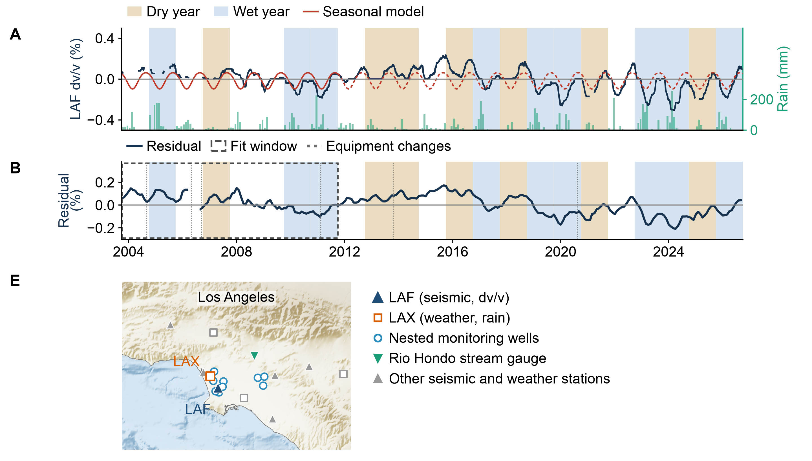

# Seismic velocity changes at station LAF, Los Angeles (2004-2026)

Scripts and processed data behind panels A, B and E of Figure 6 in the NSF proposal
*Seismic intelligence for adaptive monitoring of engineered and natural systems*
(Kumar et al., 2026). The record is the relative seismic velocity change (dv/v) at
broadband station CI.LAF from single-station cross-component correlations of ambient
noise, compared with rainfall at Los Angeles International Airport (LAX).



Panel A shows dv/v at 1-4 Hz with monthly rainfall, dry and wet water years, and a
seasonal model. Panel B shows dv/v after removing the seasonal model fitted over water
years 2004-2011, with the station's equipment changes. Panel E maps the seismic and
weather stations, the nested monitoring wells, and the Rio Hondo stream gauge. Panels C
and D of the proposal figure (groundwater prediction at well GAR2) are not part of this
repository.

## Quick start

```bash
conda env create -f environment.yml
conda activate la-aquifer-dvv
python scripts/06_plot_dvv_panels.py          # redraws the figure from the included results
```

Every intermediate product except the daily correlation functions is included, so any
step can be rerun on its own. Run all commands from the repository root. A full rerun from
the original data sources is:

```bash
python scripts/01_download_and_correlate.py   # about 80 min, network bound, resumable
python scripts/02_measure_dvv.py
python scripts/03_fetch_rainfall.py
python scripts/04_fetch_site_metadata.py
python scripts/05_map_background.py           # needs GMT on PATH, or GMT=/path/to/gmt
python scripts/06_plot_dvv_panels.py
```

| Script | What it does | Output |
|---|---|---|
| `01_download_and_correlate.py` | Downloads LAF waveforms from SCEDC for every third day and computes daily cross-component correlation functions in three frequency bands | `data/corr/LAF_YYYYMMDD.npz` (2,720 files, 85 MB, not tracked) |
| `02_measure_dvv.py` | Measures dv/v for each day and band by stretching the coda against a reference | `results/dvv_laf_2004_2026.csv` |
| `03_fetch_rainfall.py` | Downloads daily LAX precipitation from NOAA NCEI and sums it by month | `data/rain_lax_monthly.csv` |
| `04_fetch_site_metadata.py` | Downloads station coordinates and equipment changes (SCEDC), weather station coordinates (NCEI), well coordinates (Water Replenishment District) and the gauge location (USGS) | `data/sites/*.csv` |
| `05_map_background.py` | Cuts and shades the GMT Earth relief for the map region | `data/map_background.png` |
| `06_plot_dvv_panels.py` | Applies the quality threshold, smoothing and seasonal model, draws the panels, and writes every plotted series to CSV | `results/figure_laf/` |

All parameters are in `config.py`. Scripts 1, 2 and 6 accept `--station` to process another
CI station with the same settings.

## Method

**Correlation functions** (`lib/correlation.py`). Three-component broadband records
(`BH?`) are fetched with ObsPy from the SCEDC FDSN web service for every third day from
2003-10-01 to 2026-09-16, on one fixed grid anchored at 2012-01-01. Raw waveforms are
processed in memory and not stored. For each day:

1. Merge traces and fill gaps with zeros; remove the mean and a linear trend; taper.
2. Low-pass filter and resample to 20 samples per second.
3. Cut 30-minute windows. A window is used only if every component has at least 80%
   nonzero samples.
4. In each band, whiten the spectrum and apply one-bit normalization.
5. Correlate the pairs E-N, E-Z and N-Z (Hobiger et al., 2014), keep +/-60 s of lag,
   and average over all windows and pairs.
6. Keep the day only if at least 12 windows (6 h) were usable.

The bands are 1-4 Hz (nominal depth sensitivity about 50 m, used in the figure), 0.5-2 Hz
(about 200 m) and 0.2-0.8 Hz (about 450 m).

**dv/v** (`lib/dvv.py`). Each day's correlation function is normalized, and the reference
is the mean of all normalized days. For each day, stretch factors from -3% to +3% in 0.01%
steps are searched for the one that maximizes the correlation between the reference and
the stretched function over the coda window: |lag| of 2-12 s at 1-4 Hz, 2-18 s at
0.5-2 Hz, and 3-18 s at 0.2-0.8 Hz, causal and acausal sides together. dv/v is the
negative of the best stretch factor, in percent, and the maximum correlation is reported
as `cc`. The table has 2,720 days per band; 2,264 of them have `cc >= 0.6` at 1-4 Hz.

**Figure** (`06_plot_dvv_panels.py`). Days with `cc >= 0.6` at 1-4 Hz are kept. The
plotted line is a centered 20-sample rolling median (at least 7 samples), about 60 days
at the three-day stride, broken where gaps exceed 30 days. The seasonal model
dv/v(t) = a0 + sum over k = 1, 2 of [ak cos(2 pi k tau) + bk sin(2 pi k tau)], with
tau = day of year / 365.25, is fitted by least squares to the daily values in water years
2004-2011 (544 days) and drawn dashed where extrapolated; the coefficients are saved in
`results/figure_laf/seasonal_fit.json`. A water year runs from October to September and
is called dry when its rainfall is below 75% of the 2005-2025 median (247.5 mm) and wet
when above 125%. Panel B is the daily residual averaged by month and smoothed with a
centered three-month mean; the dotted lines are the dates where the station's Z-channel
metadata epoch changed (sensor or sampling rate), taken from SCEDC station metadata.

## Data sources

- Seismic waveforms and station metadata: Southern California Earthquake Data Center
  (SCEDC), Caltech, doi:10.7909/C3WD3xH1; network CI, doi:10.7914/SN/CI.
- Rainfall and weather station coordinates: NOAA National Centers for Environmental
  Information, Global Historical Climatology Network Daily, station USW00023174.
- Nested monitoring well coordinates: Water Replenishment District of Southern
  California, hydrograph site (https://hydrographs.wrd.org).
- Stream gauge: U.S. Geological Survey Water Data API, site 11101250.
- Relief: GMT Earth relief 15 arc-second grid, from SRTM15+ (Tozer, B., et al., 2019,
  Global bathymetry and topography at 15 arc sec: SRTM15+, Earth and Space Science, 6,
  1847-1864).
- Method: Hobiger, M., Wegler, U., Shiomi, K., and Nakahara, H. (2014). Single-station
  cross-correlation analysis of ambient seismic noise: application to stations in the
  surroundings of the 2008 Iwate-Miyagi Nairiku earthquake. Geophysical Journal
  International, 198, 90-109.

## Layout

```
config.py                  parameters
lib/correlation.py         download, preprocessing, whitening, cross-component correlation
lib/dvv.py                 stretching and the seasonal model
lib/stations.py            station metadata: channel epochs, equipment changes, coordinates
scripts/                   the six steps
data/corr/                 step 1 output (not tracked)
data/rain_lax_monthly.csv  step 3 output, with a manifest of the request
data/sites/                step 4 output, with a manifest of the sources
data/la_relief.nc          relief grid for step 5, with its palette and the rendered background
results/dvv_laf_2004_2026.csv            step 2 output
results/figure_laf/        figure, panel tables and seasonal fit
```

## Citation

See `CITATION.cff`. The archived release is on Zenodo (DOI to be added).
